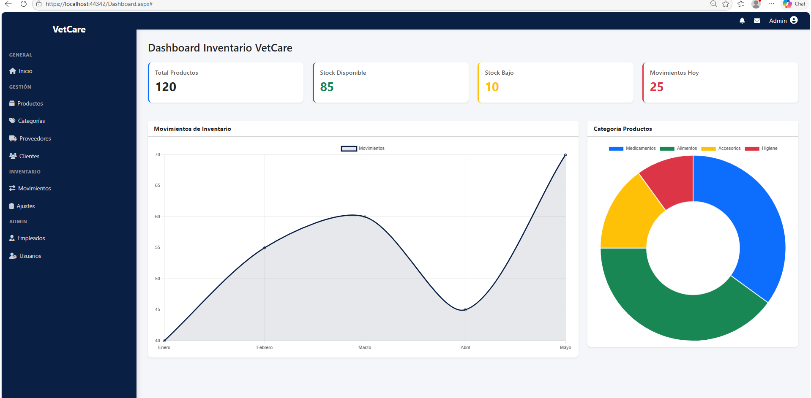
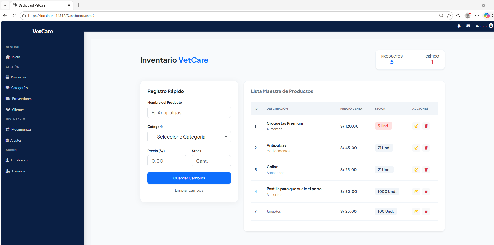
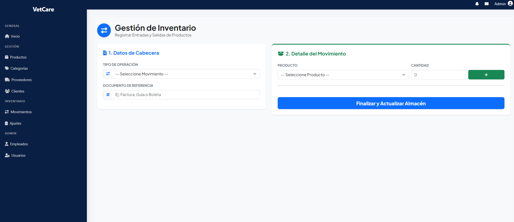

# 📦 VetCare S.A.C. - Sistema de Control de Inventario

---

## 📝 Descripción del Proyecto

**VetCare S.A.C.** es un software de escritorio enfocado en la administración eficiente del stock de insumos médicos, medicamentos y productos veterinarios. El sistema permite controlar entradas/salidas de almacén, gestionar proveedores y generar alertas visuales automáticas cuando los productos alcanzan su stock mínimo.

---

## ⚙️ Características Principales

- 🏥 **Gestión de Insumos & Medicamentos:** Registro categorizado de productos con fecha de vencimiento y lote.
- 🔔 **Alertas de Stock Mínimo:** Notificaciones en pantalla para reabastecimiento oportuno.
- 📊 **Reportes y Auditoría:** Generación de resúmenes de movimientos e historial de inventario conectados a SQL Server.
- 🔐 **Control de Acceso:** Login de usuarios con roles diferenciados (Administrador / Personal de Almacén).

---

---

## 📸 Capturas del Sistema

  <b>🔑 Inicio de Sesión / Login</b> 
  

 

  <b>📊 Dashboard Principal</b> 
  

 

  <b>📦 Gestión de Productos</b> 
  

 

  <b>📋 Control de Inventario</b> 
  

---

## 🏗️ Arquitectura y Tecnologías

- **Lenguaje:** C# (.NET Framework)
- **Interfaz:** Windows Forms / Material Design
- **Base de Datos:** Microsoft SQL Server (Procedimientos Almacenados y Triggers)
- **Patrón de Diseño:** N-Capas (Presentación, Negocio, Datos)

---

## 📬 Autor
* **John Javier Carhuachin Quispe**
* LinkedIn: [Perfil Profesional](https://www.linkedin.com/in/john-javier-32a068446/)
* Email: johncarhuaching@gmail.com
